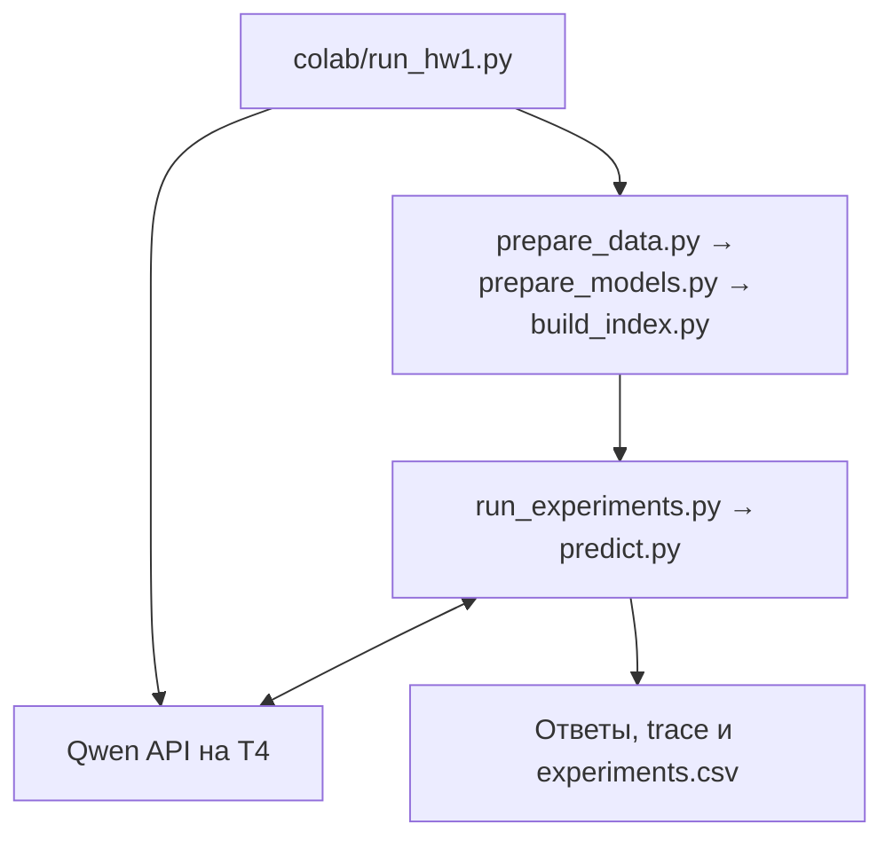

# Запуск ДЗ 1 на Colab T4

Папка `colab/` позволяет выполнять подготовку данных и эксперименты на виртуальной машине Colab. Qwen использует T4, сборка индекса и поиск — CPU этой VM. Используются исходники из `hw1/` и те же `config.json` и `runtime.json`.

## Что где лежит

| Путь | Назначение |
| --- | --- |
| [`run_hw1.py`](run_hw1.py) | Точка входа на VM: подготовка данных и модели, запуск Qwen и экспериментов. Используется и из ноутбука, и через CLI. |
| [`jobs/`](jobs/) | Пять JSON-пресетов аргументов: пробный запуск, итоговый вариант, все эксперименты, проверка своих вопросов и запуск сервера. Их различия описаны ниже. |
| [`run.ps1`](run.ps1) | Управление с Windows: синхронизация кода, запуск, проверка состояния, скачивание результатов и остановка. |
| [`project.json`](project.json), [`bundle.py`](bundle.py) | Настройки сессии и создание архива исходников для загрузки на VM. |
| [`remote/`](remote/) | Служебные скрипты, которые `run.ps1` выполняет на VM: распаковка кода, фоновый запуск, просмотр состояния, остановка и упаковка результатов. |
| [`colab.ps1`](colab.ps1) | Обёртка над установленным Colab CLI для Windows. |
| [`colab_account.ps1`](colab_account.ps1), [`colab_auth.py`](colab_auth.py) | Авторизация и выбор аккаунта CLI. |
| [`reattach.ps1`](reattach.ps1), [`reattach.py`](reattach.py) | Восстановление подключения к существующей VM при потерянной записи сессии. |
| [`colab_shim/`](colab_shim/) | Совместимость CLI с Windows и обработка журналов авторизации; загружается обёртками CLI. |

Для запуска в ноутбуке достаточно команды с `run_hw1.py` из раздела [«Запуск в ноутбуке Colab»](#запуск-в-ноутбуке-colab). Остальные инструменты обслуживают управление через Colab CLI. Метод поиска и формат ответа реализованы в основном пакете [`../homework_01_rag/`](../homework_01_rag/).

## Как это связано с решением

Точка входа — [`run_hw1.py`](run_hw1.py). Она вызывает основные Python-скрипты задания:



`run_hw1.py` скачивает исходный PDF, создаёт корпус и вопросы, готовит токенизатор и индекс, загружает закреплённые GGUF и Linux/CUDA-сборку llama.cpp. Затем он запускает Qwen и задаёт `LLM_BASE_URL`, `LLM_MODEL`, `LLM_API_KEY` и `SUBMISSION_ID` для вызовов основных скриптов. API по адресу `127.0.0.1:8089` доступен внутри VM; RAG-клиент также работает на этой VM.

## Запуск в ноутбуке Colab

В новой сессии Colab выберите T4 и выполните ячейки:

```python
!git clone https://github.com/alexlegeartis/llm-homework.git /content/llm-homework
%cd /content/llm-homework/hw1
!python -m pip install --quiet uv==0.12.1
!python -m uv run --no-project --python 3.11.15 --with-requirements requirements.txt python -u colab/run_hw1.py --mode benchmark
```

Команда создаёт окружение с Python 3.11.15 и зависимостями из `requirements.txt`, затем выполняет все пять конфигураций на 15 dev-вопросах. Для трёх пробных вопросов замените `--mode benchmark` на `--mode smoke`. Для одной итоговой конфигурации используйте `--mode benchmark --names final`.

Для проверки на восьми подготовленных мною вопросах используйте `--mode benchmark --dataset own --names final without_expansion`. Результаты сохраняются отдельно в `/content/out/own/` с теми же четырьмя файлами на каждый вариант решения. Итоговые ответы и отладочные данные находятся в `own_answers.jsonl` и `own_trace.jsonl`.

## Результаты

| Путь на VM | Содержимое |
| --- | --- |
| `/content/out/status.json` | Состояние запуска: `running`, `succeeded` или `failed` |
| `/content/out/benchmark/experiments.csv` | Сводная таблица запущенных конфигураций |
| `/content/out/benchmark/experiments/` | Ответы, trace, настройки и метрики каждой конфигурации |
| `/content/out/benchmark/dev_answers.jsonl`, `/content/out/benchmark/dev_trace.jsonl` | Итоговая конфигурация |
| `/content/out/colab_metadata.json` | Оборудование, параметры модели и сведения о сборке индекса |

В режиме `smoke` ответы и trace находятся в `/content/out/smoke/`. Файлы можно скачать через панель файлов Colab или командой `-Fetch`, описанной далее.

## Управление из Windows

Для загрузки кода, запуска и получения результатов с компьютера используются [`run.ps1`](run.ps1) и установленный `colab-cli` (проверено с 0.6.0). В [`project.json`](project.json) заданы имя сессии `llm-homework`, тип GPU T4 и исключения из пакета кода. Пресеты в [`jobs/`](jobs/) передают аргументы тому же `run_hw1.py`:

| Пресет | Что запускает |
| --- | --- |
| `smoke.json` | Три пробных dev-вопроса |
| `final.json` | Итоговую конфигурацию на всех 15 dev-вопросах |
| `benchmark.json` | Пять конфигураций на всех 15 dev-вопросах |
| `serve.json` | Qwen API внутри VM для ручной отладки |
| `own.json` | RAG со словарём и без него на восьми подготовленных мною вопросах |

При первом подключении авторизуйтесь командой `./colab/colab_account.ps1 -New homework`. Авторизация и список сессий CLI общие для проектов; выполняйте его команды последовательно.

Команды выполняются из `hw1/`:

```powershell
Set-ExecutionPolicy -Scope Process -ExecutionPolicy Bypass
. ./project_env.ps1
./colab/colab.ps1 sessions
./colab/run.ps1 -Project ./colab/project.json -Sync -Job ./colab/jobs/smoke.json
```

Проверяйте ход выполнения:

```powershell
./colab/run.ps1 -Project ./colab/project.json -Poll
```

Для завершённого прогона `smoke`, `final` или `benchmark` должно появиться `state: succeeded`. Затем скачайте результаты:

```powershell
./colab/run.ps1 -Project ./colab/project.json -Fetch ./.cache/colab-results
```

`-Sync` загружает код из `hw1/`; данные, индекс, веса, окружение и кэши создаются на VM. `-Job` запускает выбранный пресет, `-Poll` показывает ход выполнения, `-Fetch` скачивает содержимое `/content/out/`. Например, таблица после указанного скачивания находится в `.cache/colab-results/benchmark/experiments.csv`.

Для проверки на восьми подготовленных мною вопросах:

```powershell
./colab/run.ps1 -Project ./colab/project.json -Sync -Job ./colab/jobs/own.json
```

Полный пресет запускает две копии Qwen на одной T4 и распределяет пять вариантов между ними. Веса и параметры генерации одинаковы. При запуске в ноутбуке добавьте `--replicas 2` для такого же режима. По умолчанию `run_hw1.py` запускает одну копию.

Для полного прогона:

```powershell
./colab/run.ps1 -Project ./colab/project.json -Sync -Job ./colab/jobs/benchmark.json
```

Веса сохраняются в `/content/llm-cache` на время жизни VM; повторная синхронизация кода использует этот кэш. Перед следующим `-Sync` дождитесь завершения задачи или остановите её:

```powershell
./colab/run.ps1 -Project ./colab/project.json -StopJob
```

После скачивания результатов освободите VM:

```powershell
./colab/run.ps1 -Project ./colab/project.json -Stop
```

Если после ошибки 404/401 сессия отображается как `[?]`, выполните `./colab/reattach.ps1`, затем повторите команду. Скрипт восстанавливает доступ к существующей VM.
